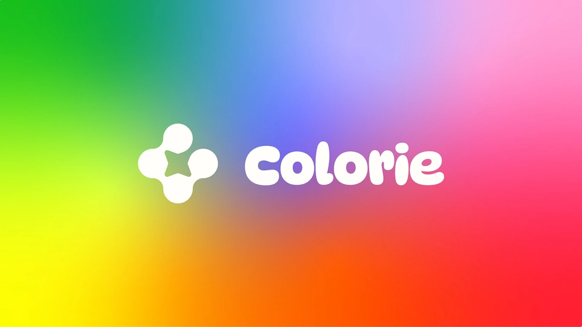
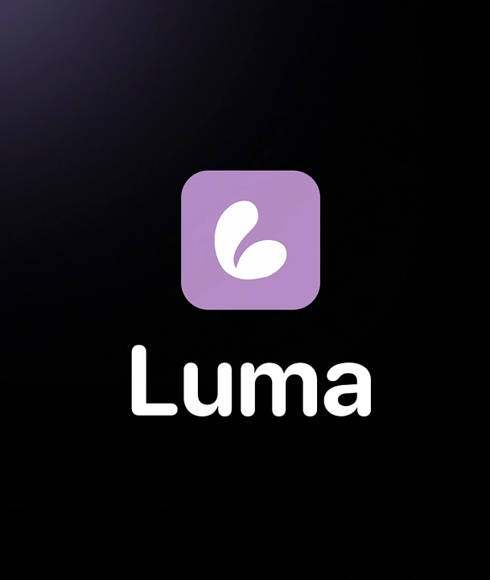
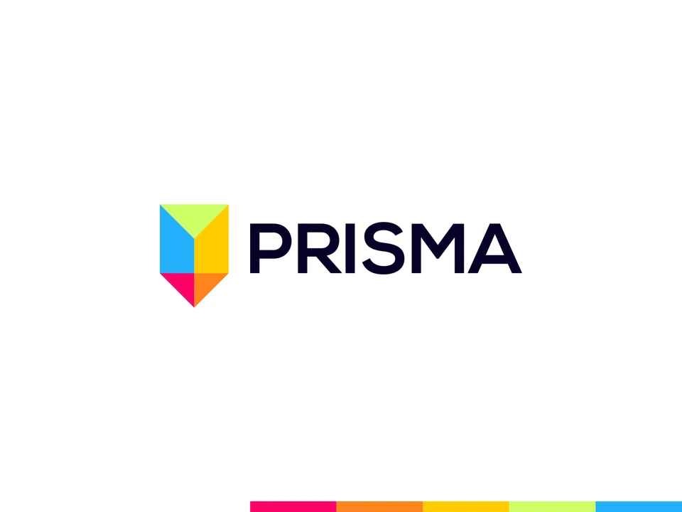
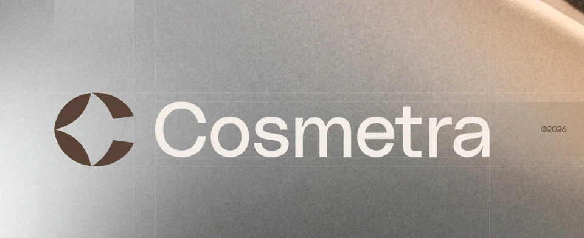
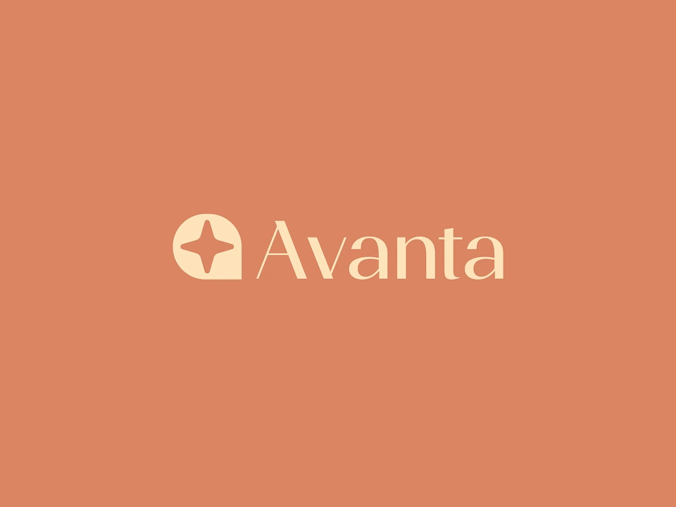
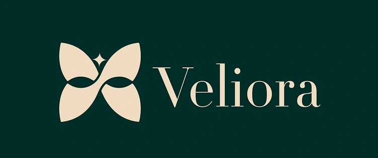
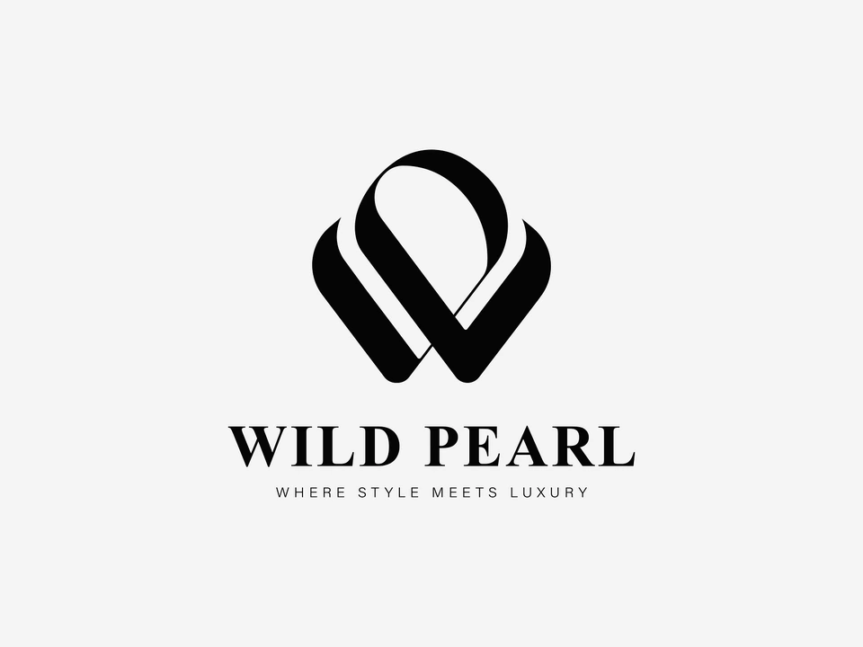
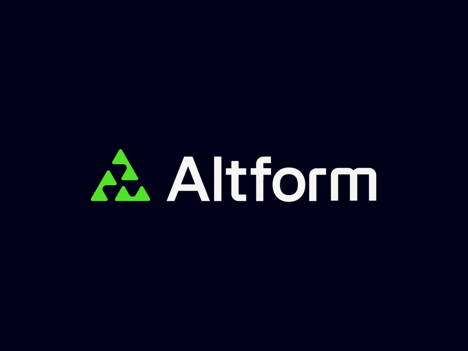

# CELEBER 로고 레퍼런스

퍼스널 컬러를 진단하고 좋아하는 연예인의 스타일을 내게 맞게 적용하는 CELEBER에 어울리는 Dribbble 사례 10개를 골랐다. 모두 단순한 심볼과 워드마크 조합이다. 일부 이미지는 로고가 잘 보이도록 필요한 영역을 잘라냈다. [CELEBER 서비스 콘셉트](../../CONTEXT.md)

### 01 Colorie

네 방향으로 퍼지는 둥근 심볼과 부드러운 레터링이 색 발견을 친근하게 표현한다. CELEBER에서는 같은 심볼에 진단 결과별 컬러를 적용하는 방식을 참고할 수 있다. [Annisa · Pickolab Studio / Dribbble](https://dribbble.com/shots/27665601-AI-Personal-Color-Analysis-Logo-Branding)

### 02 Luma

두 개의 둥근 면으로 이루어진 심볼을 앱 아이콘에 담고, 그 아래에 간결한 산세리프 워드마크를 배치했다. 퍼스널 컬러와 코디 추천을 함께 다루는 서비스라 아이콘과 워드마크를 한 화면에 배치하는 방식이 직접적인 참고가 된다. [Saifulloh Rahman / Dribbble](https://dribbble.com/shots/27590538-Luma-Personal-Color-Analysis-Outfit-Inspiration-App)

### 03 Prisma

여러 색면을 하나의 프리즘 안에 모으고 대문자 워드마크를 단색으로 유지했다. 조명에 따라 다르게 보이는 피부색에서 개인의 팔레트를 찾아낸다는 개념을 시각화할 때 참고할 수 있다. [Alex Tass / Dribbble](https://dribbble.com/shots/26454702-Prisma-architecture-studio-logo-design)

### 04 Cosmetra

열린 원의 중앙 여백이 빛처럼 보이고, 바깥 실루엣은 브랜드의 첫 글자 C를 연상시킨다. CELEBER의 C에 촬영이나 빛을 암시하는 여백을 결합하는 방식에 참고할 만하다. [Emon / Dribbble](https://dribbble.com/shots/27811504-Cosmetra-Skincare-Brand-Logo-Design)

### 05 Avanta

둥글게 닫힌 외곽 안에 네 꼭짓점의 별을 넣고, 가는 세리프 워드마크와 나란히 배치했다. 원하는 스타일에서 나에게 어울리는 요소를 발견하는 순간을 작은 심볼로 표현할 때 참고할 수 있다. [HESA STUDIO / Dribbble](https://dribbble.com/shots/27897258-Fashion-Management-Logo-Design)

### 06 Veliora

네 개의 면을 대칭으로 배치해 나비 형상을 만들고, 대비가 뚜렷한 세리프를 곁들였다. 연예인의 스타일을 참고해 자신의 분위기를 바꿔 보는 경험을 추상적인 형태로 보여주는 데 참고할 만하다. [Samina M / Dribbble](https://dribbble.com/shots/27131202-Veliora-Luxury-Beauty-Skincare-Brand-Logo-Design)

### 07 Wild Pearl

두 이니셜을 한 덩어리로 묶은 모노그램을 자간이 넓은 대문자 세리프 위에 놓았다. CELEBER의 긴 글자 수와 작은 화면을 고려해, 전체 이름과 독립적인 심볼의 비례를 잡는 데 참고할 수 있다. [Anik Paul / Dribbble](https://dribbble.com/shots/27633082-Minimalist-Fashion-Logo-Fashion-Logo-Luxury-logo-logo-design)

### 08 Veloura

잎을 연상시키는 곡선을 원 안에 모으고 둥근 산세리프와 짝지었다. CELEBER의 컬러 샘플이나 얼굴 윤곽을 하나의 원형 아이콘 안에 정리하는 방식에 참고할 만하다. [Nixtio Branding / Dribbble](https://dribbble.com/shots/26864304-Cosmetics-Brand-Logo-Design)

### 09 RECALL

퍼지는 부채꼴과 대문자 워드마크를 하나의 아치형 실루엣에 담았다. 퍼스널 컬러 진단에 쓰이는 색상 견본을 부채처럼 펼친 형태와, 이름을 작은 면적에 함께 담는 구성이 참고할 만하다. [Valeria Ruban / Dribbble](https://dribbble.com/shots/26524952-RECALL-jewelry)

### 10 Altform

작은 삼각형이 모여 큰 삼각형을 이루고, 글자는 담백한 산세리프로 균형을 잡는다. 피부 톤, 얼굴 윤곽, 코디처럼 여러 분석 항목을 한눈에 알아볼 수 있는 하나의 형태로 모으는 방식에 참고할 수 있다. [Deividas Bielskis / Dribbble](https://dribbble.com/shots/27727709-Altform)
