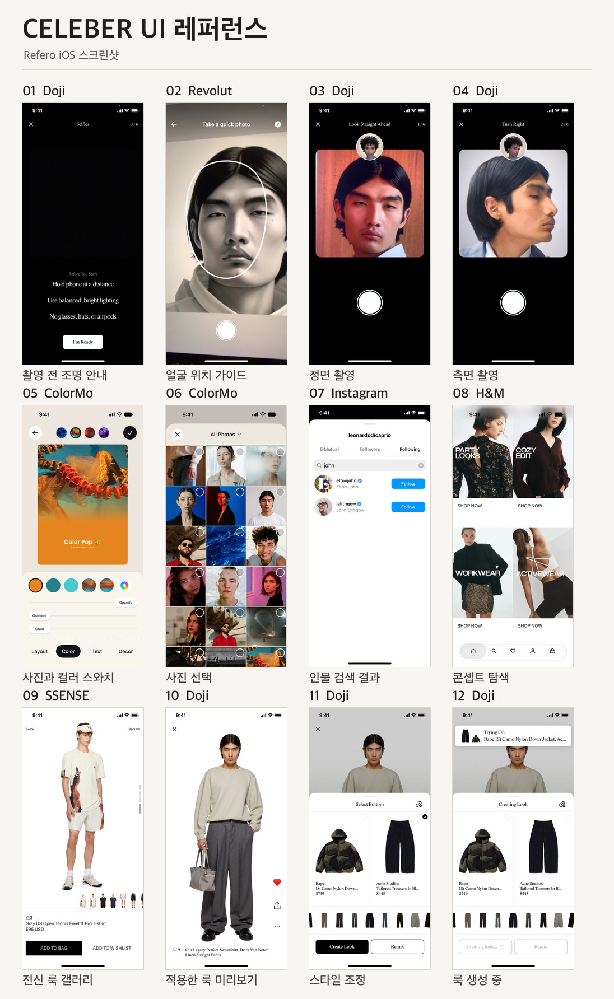

# CELEBER UI 레퍼런스

[CELEBER 제품 맥락](../../CONTEXT.md)에 맞춰 촬영과 퍼스널 컬러 진단, 연예인 추구미 탐색, 나에게 맞춘 스타일 가이드에 참고할 iOS 화면 12장을 골랐다. Refero의 iOS 목록에서 앱을 찾고 `Camera & Scanner`, `Color Picker`, `Search Field`, `Product Details` 태그로 화면을 좁혔다. [Refero iOS 앱 목록](https://refero.design/ios-apps)

## CELEBER에 적용할 디자인 방향

**촬영에서 조건과 다음 행동을 한눈에 보여준다.** 어두운 카메라 화면에 흰 윤곽선과 한 줄 안내를 두고, `환경 → 정면 → 측면 → 전신(선택)` 순서로 진행한다. 환경 단계에서는 밝기와 실내·실외 판정 결과를 보여주고, 재촬영이 필요하면 이유와 다음 행동을 함께 표시한다. 정면과 측면은 같은 위치에 자세 예시와 촬영 버튼을 둔다.

**진단 결과에는 피부색과 추천 팔레트를 구분해 보여준다.** 중립적인 밝은 배경에 피부색을 추출한 사진 영역과 색 견본을 나란히 배치한다. 추천 팔레트는 ‘추천 의상색’으로 따로 라벨링하고 색 이름을 함께 표시한다. 사진과 색 견본이 화면에서 가장 먼저 보이도록 제목과 버튼의 색은 절제한다.

**추구미 탐색은 이름 검색과 사진 선택에서 시작한다.** 검색 결과는 인물 사진과 이름을 한 줄에 묶고, 사진을 올렸을 때는 미리보기에서 분석 가능 여부와 다음 행동을 표시한다. 인물 상세는 `대표 룩 · 최근 룩 · 평소 룩`을 사진 카드로 나누고, 각 룩에서 코디와 팔레트를 바로 확인할 수 있게 한다.

**스타일 가이드는 바로 적용할 변화부터 보여준다.** ‘내 팔레트’와 ‘선택한 룩의 팔레트’를 같은 크기의 색 견본으로 나란히 놓는다. 그 아래에 얼굴 주변 컬러, 코디, 분위기의 차이를 각각 사진과 한 줄 설명으로 보여준다. 전신 미리보기와 항목별 제안을 연결해, 예를 들어 상의 색을 바꾸면 전체 룩이 어떻게 달라지는지 볼 수 있게 한다. 팔레트 비교 구성은 ColorMo의 스와치와 Doji의 룩 미리보기에서 가져온 CELEBER용 제안이다.

## 원본 화면과 선정 근거

| 화면 | 원본에서 참고할 부분 | Refero |
| --- | --- | --- |
| [01 · 촬영 전 조명 안내](screens/01-doji-lighting-guide.jpg) | Doji는 촬영 전에 거리, 조명, 액세서리 조건을 짧게 안내한다. CELEBER의 환경 촬영 전 안내에 활용한다. | [Doji](https://refero.design/screens/b36c03a8-0781-4bb3-be6d-73277c1625e0) |
| [02 · 얼굴 위치 가이드](screens/02-revolut-face-framing.jpg) | Revolut은 카메라 영상 위에 흰 타원으로 얼굴 위치를 표시한다. 얼굴 윤곽을 촬영할 때 거리와 위치를 잡는 데 참고한다. | [Revolut](https://refero.design/screens/6c487e9b-db24-4d10-822b-cbb3e04e2b71) |
| [03 · 정면 촬영](screens/03-doji-front-selfie.jpg) | Doji는 상단 단계 표시, 정면 자세 예시, 중앙 셔터로 현재 행동을 명확히 보여준다. | [Doji](https://refero.design/screens/c158e8cc-a803-4ee4-b226-c0038b603e95) |
| [04 · 측면 촬영](screens/04-doji-side-selfie.jpg) | 정면 화면과 같은 구조에서 예시 사진과 지시 문구가 바뀐다. 측면 촬영에서도 버튼 위치와 조작을 유지하는 데 참고한다. | [Doji](https://refero.design/screens/6858e05e-18e5-4abd-bf8d-0193eb38cd2d) |
| [05 · 사진과 컬러 스와치](screens/05-colormo-color-swatches.jpg) | ColorMo는 큰 사진 바로 아래에 원형 색 견본을 놓는다. 피부색을 추출한 사진과 팔레트가 어떻게 연결되는지 보여주는 데 참고한다. | [ColorMo](https://refero.design/screens/0ccea563-b437-4c88-9390-2e21ababc189) |
| [06 · 사진 선택](screens/06-colormo-photo-picker.jpg) | ColorMo는 앨범 이름 아래에 사진을 3열로 배치하고 각 썸네일에 선택 상태를 표시한다. 연예인 사진과 선택형 전신 사진을 가져오는 진입점에 참고한다. | [ColorMo](https://refero.design/screens/7f810f2c-9de7-472c-b3da-8932b1049dce) |
| [07 · 인물 검색 결과](screens/07-instagram-people-search.jpg) | Instagram의 팔로잉 검색은 검색어 아래에 인물 사진, 이름, 계정명을 함께 표시한다. 이름이 비슷한 인물을 구분하는 결과 행에 참고한다. | [Instagram](https://refero.design/screens/de48cb36-3f3a-4075-a2c8-95557a6f4abb) |
| [08 · 콘셉트 탐색](screens/08-hm-concept-grid.jpg) | H&M은 콘셉트 이름을 화보 위에 직접 올리고 사진을 2열로 보여준다. 대표·최근·평소 룩을 사진으로 훑는 상세 화면에 참고한다. | [H&M](https://refero.design/screens/cc89124f-a089-4dd0-adf7-ccad554363f5) |
| [09 · 전신 룩 갤러리](screens/09-ssense-outfit-gallery.jpg) | SSENSE는 전신 사진과 하단 썸네일로 전체 실루엣과 다른 시점을 오가게 한다. 연예인 코디 상세와 전신 비율 결과의 사진 배치에 참고한다. | [SSENSE](https://refero.design/screens/822c4430-2c00-470a-965e-c2a3eb1e20d4) |
| [10 · 적용한 룩 미리보기](screens/10-doji-outfit-preview.jpg) | Doji는 중립 배경에 전신 룩을 크게 보여주고 착장 정보를 아래에 둔다. 스타일 가이드 결과에서 실루엣과 색 조합을 먼저 읽히게 한다. | [Doji](https://refero.design/screens/c3944acd-0ecd-4ad1-a313-4c766a00a357) |
| [11 · 스타일 조정](screens/11-doji-outfit-adjustment.jpg) | Doji는 인물 미리보기를 남겨 둔 채 하단 패널에 코디 후보를 보여준다. 추천 상의나 색 조합을 탐색할 때 인물과 선택지를 함께 보이는 패턴이다. | [Doji](https://refero.design/screens/e711fba0-b28e-42d8-9d07-d4766794b024) |
| [12 · 룩 생성 중](screens/12-doji-building-look.jpg) | Doji는 고른 코디와 인물 미리보기를 유지하면서 생성 중 상태를 표시한다. CELEBER의 사진 분석이나 가이드 생성 중 맥락을 유지하는 데 참고한다. | [Doji](https://refero.design/screens/1a8f5c8c-d5ba-4102-b47e-153ad6b067e6) |
