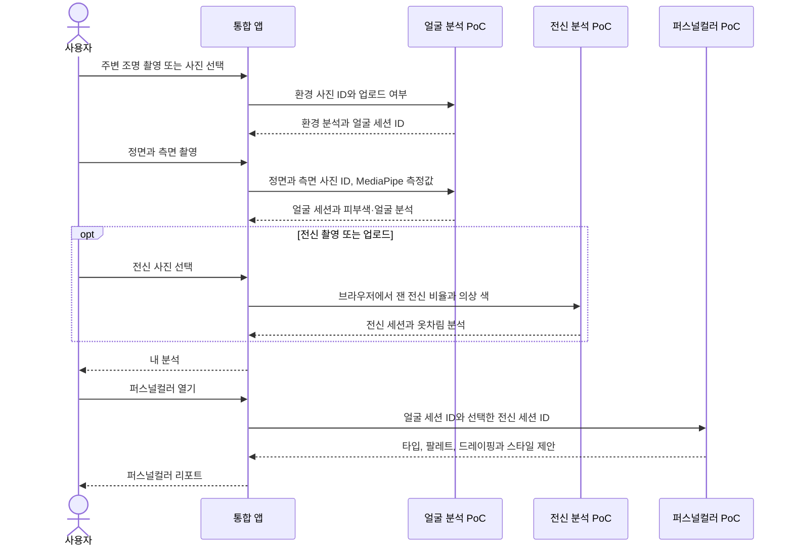
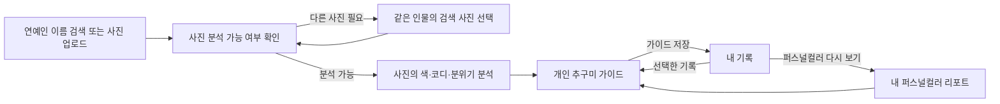

# 통합 앱 흐름

통합 앱은 `apps/web`의 Next.js 앱이다. 화면은 v4 목업의 컴포넌트를 재사용한다. 각 PoC는 기존 포트에서 실행할 수 있다. 통합 앱은 같은 출처에서 PoC API를 호출한다. 첫 방문에서 자동 발급한 쿠키가 같은 브라우저의 기록을 연결한다. 사진과 분석 결과는 해당 세션의 SQLite와 업로드 폴더에 저장한다. 다른 브라우저에서 접속하거나 쿠키를 지우면 새 세션이 시작된다.

## 촬영과 분석

## 추구미와 기록

| 동작 | 주요 입력 | 저장하거나 표시하는 결과 |
|---|---|---|
| 얼굴 분석 | 환경 세션, 정면·측면 사진, 얼굴 좌표와 촬영 품질 | 피부색, 얼굴 특징, 헤어스타일, 측정 주의 사항 |
| 전신 분석 | 전신 사진과 브라우저가 계산한 포즈 | 전신 세션, 신체 비율, 의상 색상과 옷차림 |
| 퍼스널컬러 생성 | 얼굴 세션 ID, 선택한 전신 세션 ID | 퍼스널컬러 리포트 ID, 추천색과 스타일 제안 |
| 추구미 사진 분석 | 연예인과 사진 ID 또는 올린 사진, 분석 가능 상태 | 사진별 코디, 퍼스널컬러 추정, 분위기 |
| 가이드 생성·저장 | 내 리포트 ID, 연예인 사진 분석 ID | 사진별 가이드 ID, 얼굴·코디·분위기 제안, 저장 여부 |
| 내 정보 초기화 | 삭제 항목 확인, 사용자 확인 | 내 분석·리포트·가이드와 관련 사진 삭제, 연예인 검색 및 사진 분석 보존 |

상세 요청과 응답은 [최소 API 계약](api-contract.md)에 있다.

## 사람이 확인할 항목

1. 모바일에서 카메라 권한을 허용하고 환경·정면·측면을 촬영한다. 전신을 추가한 경우와 건너뛴 경우를 확인한다.
2. 내 분석 사진과 수치가 방금 촬영한 내용과 맞는지 확인한다. 퍼스널컬러의 드레이핑과 의상·헤어 추천을 살펴본다.
3. 연예인 이름으로 검색한 뒤 각 사진의 출처를 열어 본다. 분석하기 어려운 사진을 올리고 같은 인물의 다른 사진으로 가이드를 만든다.
4. 다른 사진으로 만든 가이드를 저장하고, 내 기록에서 각각 열어 인물과 사진이 맞는지 확인한다. 퍼스널컬러도 다시 연다.
5. 데스크톱에서 iPhone 프레임 안을 스크롤하고 모바일에서 화면과 버튼이 안전 영역 안에 들어가는지 확인한다.
6. 테스트 데이터에서만 초기화를 확인하고 목록과 사진이 정리되는지 확인한다.
